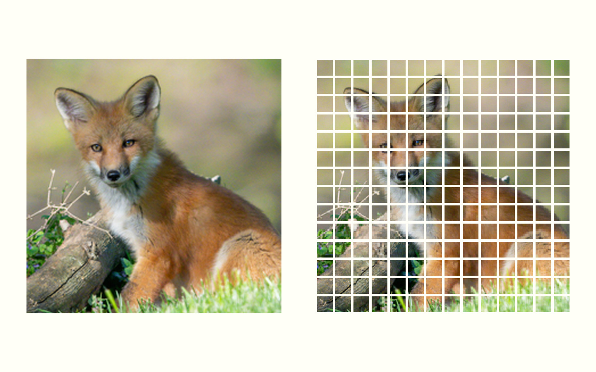
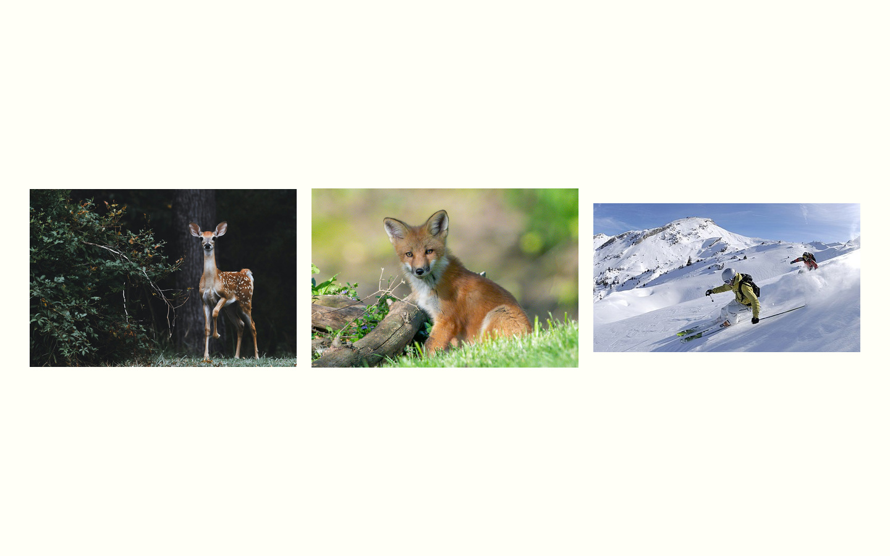

# Image captioning

An image goes in, a sentence comes out.



## Why I built this

A friend challenged me to build an image captioning model. I had no deep learning experience at the time, so this became a speedrun of the research and a way to learn by building something that actually worked.

I started with LSTMs, then tried Transformers, and came back to the project with a ViT image encoder. Along the way I wrote the word tokenizer, data loading, training loop, and inference code. The older notebooks are still here because they show where I started.

## How it works

The current model is in [the January 8 notebook](01-08-26-coco2017-image-captioning.ipynb).

The image is cropped to 224 × 224 pixels and passed through a pretrained ViT-B/16. It splits the image into 196 patches of 16 × 16 pixels, adds a class token, and turns those into a sequence of features. I keep those patch features instead of taking the final classification output. A linear layer projects them from 768 dimensions to 512 for the caption decoder.

The decoder is a four-layer Transformer with eight attention heads. It attends to the image features and the words it has already seen to predict the next word. During training, I feed it a caption shifted by one word and compare its predictions with the next words in the original caption. Padding is ignored in the loss.

The tokenizer is a word dictionary built from the training captions. Captions are lowercased, punctuation is removed, and words appearing fewer than five times become `<UNK>`. I add `<START>`, `<END>`, and `<PAD>` tokens, then map words to integer IDs. There's no pretrained text tokenizer or language model in this version.

The ViT uses ImageNet weights from torchvision and is frozen in the current training configuration. The decoder uses PyTorch's Transformer layers. The captioning model and pipeline are my own implementation around those components.

At inference, decoding starts with `<START>` and continues until `<END>` or the length limit. The notebooks include greedy decoding, beam search, and top-p sampling.

## Some examples



These are captions from the saved run in [benchmark.ipynb](benchmark.ipynb):

| Image | Model caption |
| --- | --- |
| Skiers | a person riding skis down a snow covered slope |
| Fox | a brown and white cat standing next to a tree |
| Deer | a couple of giraffe standing next to each other |

The skiing caption is pretty reasonable. The fox and deer are good examples of what still goes wrong: the sentence can sound plausible while getting the animal completely wrong.

The patch images in this README show how the input is divided up. They aren't attention maps or model predictions. All three text-free visuals are in [images/readme/](images/readme/).

## Finding your way around

| Notebook | What's in it |
| --- | --- |
| [01-08-26-coco2017-image-captioning.ipynb](01-08-26-coco2017-image-captioning.ipynb) | Current ViT + Transformer model, COCO preprocessing, training, checkpoints, and sampling. Start here for the model. |
| [benchmark.ipynb](benchmark.ipynb) | Load a checkpoint, caption your own images, and evaluate on COCO. Start here to try inference. |
| [01-07-26-coco2017-image-captioning.ipynb](01-07-26-coco2017-image-captioning.ipynb) | Earlier January experiment. |
| [07-01-24-lstm-coco2017-image-captioning.ipynb](07-01-24-lstm-coco2017-image-captioning.ipynb) | Early LSTM experiment on COCO. |
| [07-01-24-lstm-flickr30k-image-captioning.ipynb](07-01-24-lstm-flickr30k-image-captioning.ipynb) | Early LSTM experiment on Flickr30k. |
| [07-01-24-vanilla-transformer-flickr30k-image-captioning.ipynb](07-01-24-vanilla-transformer-flickr30k-image-captioning.ipynb) | Early Transformer experiment on Flickr30k. |

## Running it

From the repo root:

```bash
python -m venv .venv
source .venv/bin/activate
pip install -r requirements.txt
pip install jupyterlab matplotlib
jupyter lab
```

The code lives in notebooks; there isn't a separate training or inference CLI. Run them with the repo root as the working directory. The January training notebooks were written on Kaggle, so their dataset paths need changing for a local run.

### Caption your own images

Open `benchmark.ipynb` and find the **tweakable constants** cell:

```python
CHECKPOINT_PATH = 'models/vit_transformer_coco_captioner_2026-01-08_best.ckpt'
IMAGES_DIR = './images'
MODE = 'beam'  # also 'greedy' or 'top_p'
RUN_COCO = False
```

Put your photos in `images/` and run the cells in order. Setting `RUN_COCO = False` lets you try your photos without downloading COCO. PyTorch selects CUDA when available and otherwise uses the CPU. The ViT constructor also downloads its pretrained weights on first use if they aren't cached.

The trained checkpoint and datasets aren't checked into Git. You need an existing checkpoint or a training run first. The checkpoint must contain `model_state_dict`, `config`, `stoi`, and `itos`; a bare `.pth` state dictionary isn't enough for the benchmark loader.

### Train a model

Open `01-08-26-coco2017-image-captioning.ipynb` and change `coco_path` to your COCO 2017 directory. It should contain `train2017/`, `val2017/`, and `annotations/` with `captions_train2017.json` and `captions_val2017.json`.

Run the notebook in order. The training constants are set to 10 epochs and a batch size of 512; lower the batch size if it doesn't fit your GPU. Training uses AdamW, a cosine learning-rate schedule, and gradient clipping.

The notebook saves best and last `.ckpt` files plus a `.pth` weights file in its working directory. Filenames include the run date. Point `CHECKPOINT_PATH` in the benchmark notebook at your saved `.ckpt`.

## Evaluation

The saved benchmark used **100 randomly sampled COCO val2017 images**, seed 0, with beam search and `vit_transformer_coco_captioner_2026-01-08_best.ckpt`.

| Metric | Saved result |
| --- | ---: |
| BLEU-1 | 0.7087 |
| BLEU-2 | 0.5555 |
| BLEU-3 | 0.4337 |
| BLEU-4 | 0.3365 |
| METEOR | 0.5016 |
| ROUGE-L | 0.5462 |
| CIDEr | 0.8862 |

That run took 132.62 seconds, or 0.754 images per second. The hardware wasn't recorded with the result.

These are the notebook's metrics on a small validation sample. BLEU and METEOR use NLTK, ROUGE-L uses the notebook's LCS implementation, and CIDEr uses `pycocoevalcap`. This isn't a full COCO evaluation using the official evaluation pipeline.

To repeat the setup, set `RUN_COCO = True`, check `COCO_IMAGES_DIR` and `COCO_ANN_JSON`, and leave `COCO_EVAL_N = 100`. For METEOR and CIDEr, also install:

```bash
python -m nltk.downloader wordnet omw-1.4
pip install git+https://github.com/salaniz/pycocoevalcap
```

## Papers I started with

- [Deep Visual-Semantic Alignments for Generating Image Descriptions](https://cs.stanford.edu/people/karpathy/cvpr2015.pdf)
- [Show and Tell: A Neural Image Caption Generator](https://arxiv.org/abs/1411.4555)
